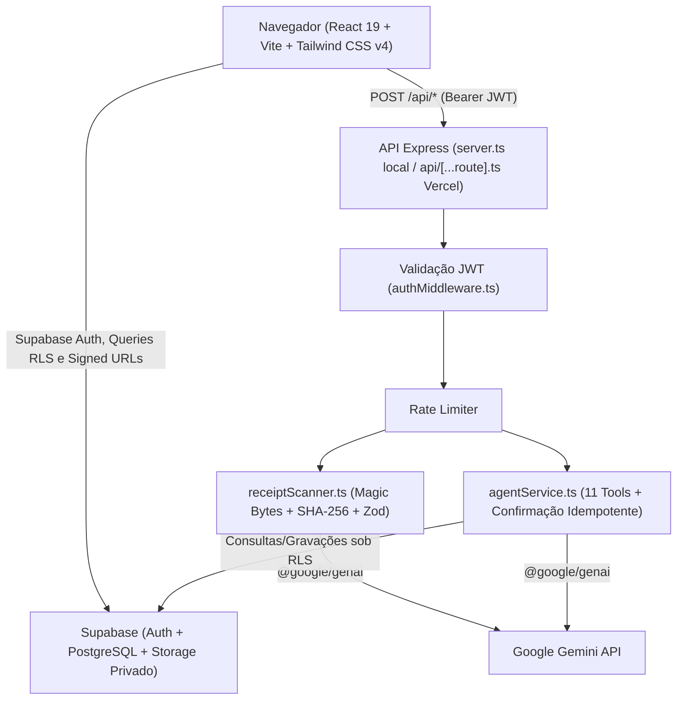
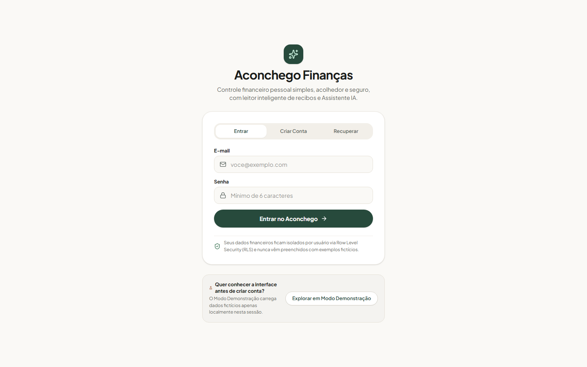
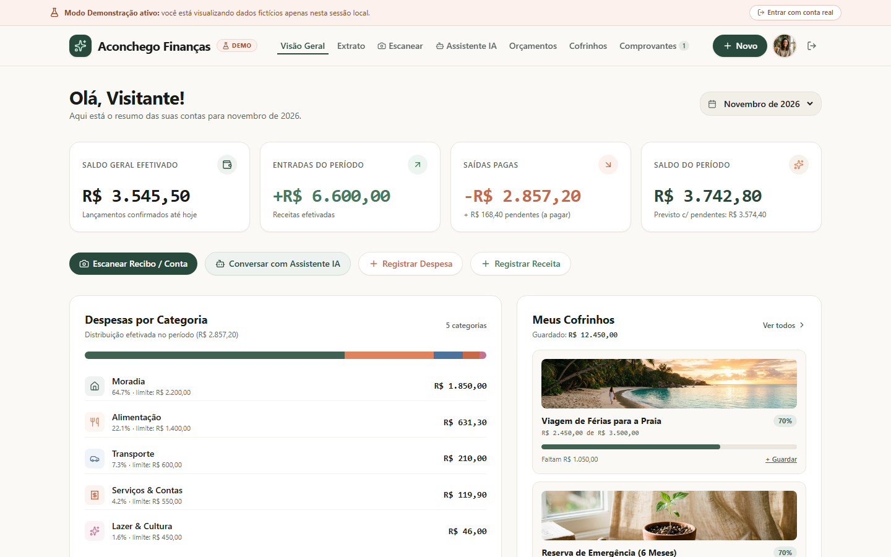
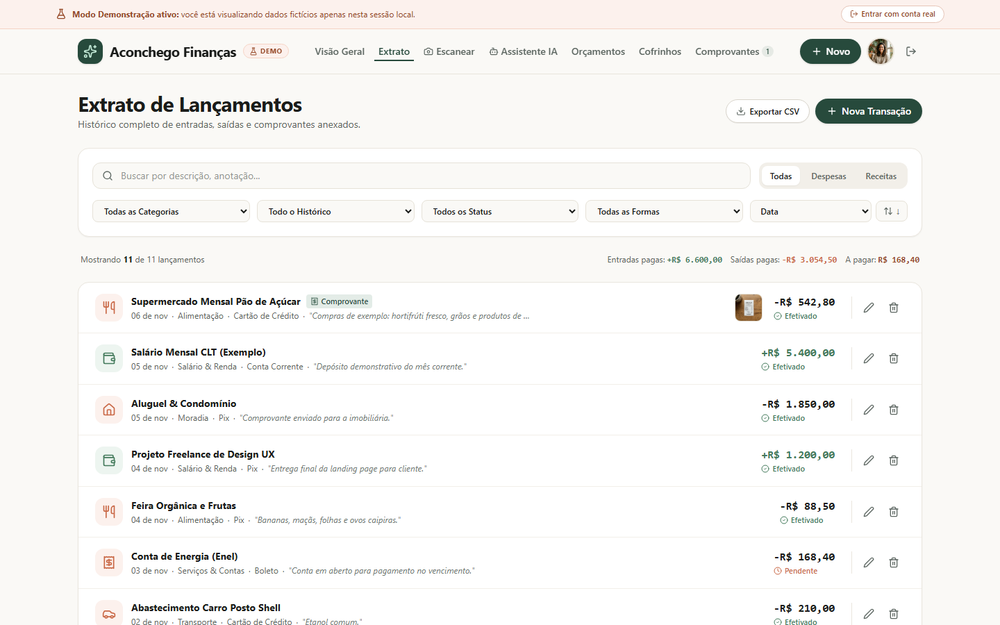
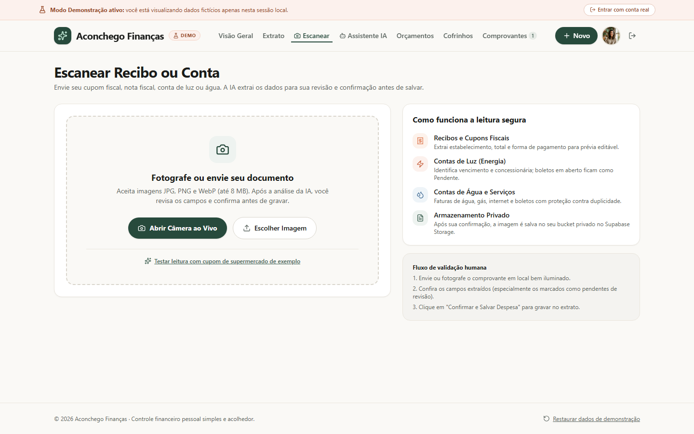
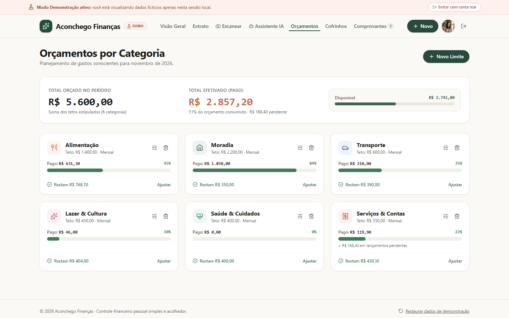
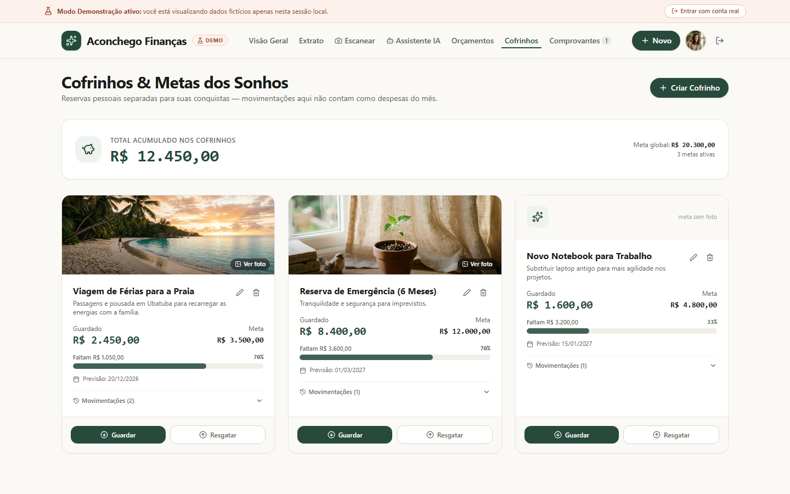
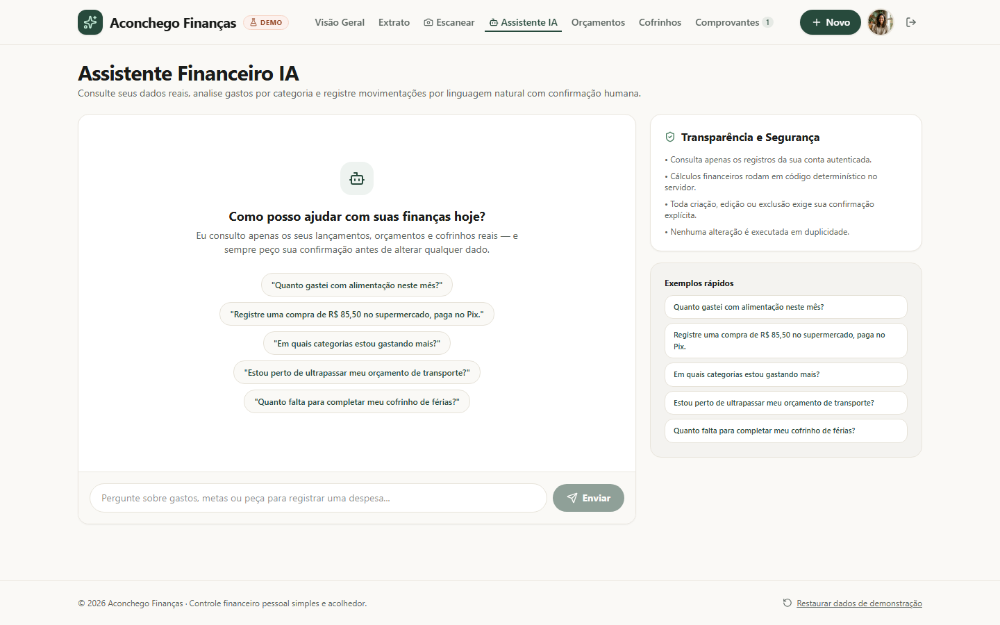
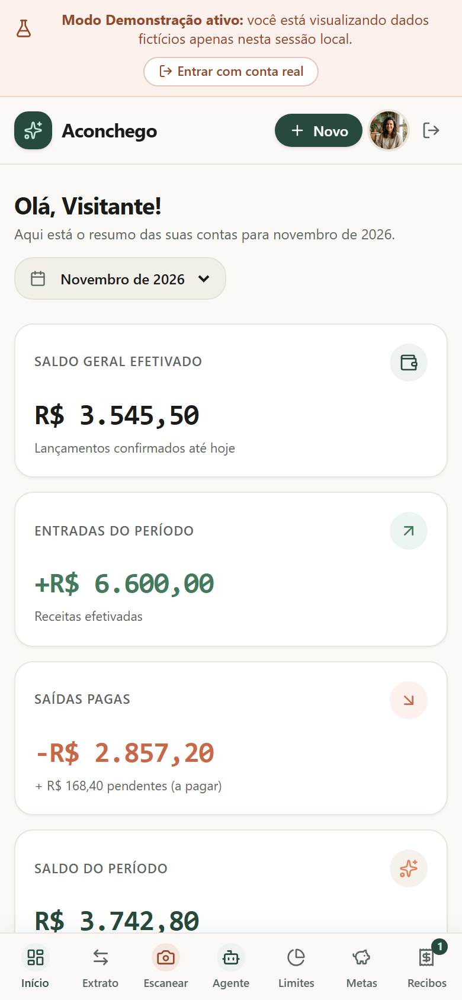

# Aconchego Finanças

Aplicação web full stack de controle financeiro pessoal construída para oferecer clareza, tranquilidade e segurança no acompanhamento de receitas, despesas, orçamentos por categoria, cofrinhos (metas pessoais), leitura assistida de comprovantes e **Agente Financeiro Gemini** com confirmação humana obrigatória.

---

## 1. Apresentação

O **Aconchego Finanças** preserva uma identidade visual acolhedora em tons de bege quente (`#FAF9F6`), verde floresta (`#274A3C` / `#3F6253`) e terracota (`#E0835D` / `#C96846`), combinada a uma arquitetura segura baseada em **React, TypeScript, Vite, Tailwind CSS, Express/Vercel Functions, Supabase (PostgreSQL + Auth + Storage + RLS) e Google Gemini API (`@google/genai`)**.

## 2. Problema e Proposta de Solução

Ferramentas financeiras pessoais frequentemente sofrem de dois extremos: planilhas rígidas que exigem digitação manual constante, ou aplicativos complexos e impessoais. Por outro lado, protótipos com IA sem persistência em nuvem ou sem validação humana podem perder dados em `localStorage`, misturar contas pendentes como pagas ou gravar lançamentos incorretos automaticamente.

**Solução implementada:**
- Persistência multiusuário isolada por **Row Level Security (RLS)** no Supabase PostgreSQL e arquivos privados no Supabase Storage.
- Separação explícita entre transações **efetivadas (`paid`)** e **pendentes (`pending`)**, evitando dupla contagem e falsos estouros.
- Regras monetárias determinísticas em centavos inteiros (`src/utils/financeMath.ts`).
- Scanner de comprovantes com prévia editável e **confirmação humana obrigatória** antes de persistir.
- Agente de IA Gemini conectado a **11 ferramentas tipadas (function calling)** que consulta exclusivamente dados reais do usuário e exige aprovação humana para toda operação de escrita, com proteção idempotente contra execução duplicada.

## 3. Funcionalidades Existentes e Evoluções Implementadas

### Base preservada do protótipo inicial (commit `1a9658b`)
- **Visão Geral (`DashboardView`)**: Cartões de resumo financeiro, distribuição de despesas por categoria, cofrinhos em destaque e lançamentos recentes.
- **Extrato (`TransactionsView`)**: Listagem completa com busca, filtros por tipo/categoria/período/status e exportação CSV.
- **Escanear (`ScanReceiptView`)**: Captura via câmera ao vivo, envio de imagem e leitura com Gemini.
- **Orçamentos (`BudgetsView`)**: Controle de teto de gastos por categoria com alertas visuais.
- **Cofrinhos (`PiggyBanksView`)**: Metas de economia com barra de progresso, depósitos e resgates.
- **Comprovantes (`ReceiptsGalleryView`)** e **Lightbox (`ImageLightboxModal`)**: Galeria visual de recibos vinculados às transações.

### Evoluções implementadas nesta versão
- **Autenticação completa (`AuthView`)**: Cadastro, login, logout, recuperação de senha, atualização de senha via link de recuperação e **Modo Demonstração** voluntário (dados fictícios de `initialData.ts` nunca são importados para contas reais novas).
- **Persistência Supabase + Storage Privado (`financeRepository.ts`)**: Substituição do armazenamento exclusivo em `localStorage` por PostgreSQL com RLS, URLs assinadas temporárias e proteção anti-duplicidade via `file_hash` SHA-256 e `idempotency_key`.
- **Correções estruturais**: Mês inicial dinâmico (`getCurrentYearMonth()`), empacotamento estático de imagens (`src/utils/assets.ts`), filtro por forma de pagamento e ordenação por data/valor no extrato, exclusão de orçamentos, bloqueio de resgate acima do saldo e histórico de movimentações (`goal_contributions`) nos cofrinhos.
- **Scanner Gemini corrigido**: Substituição do modelo `gemini-4-hydrogen` por `GEMINI_MODEL` (padrão `gemini-2.5-flash`, com contingência automática para `gemini-flash-lite-latest`), cliente `@google/genai` com `apiVersion: 'v1beta'`, validação de magic bytes (JPG/PNG/WebP até 8 MB), timeout de 25s, sinalização de `uncertainFields` e remoção do registro automático sem confirmação.
- **Novo Assistente Financeiro IA (`AgentAssistantView`)**: Interface conversacional com histórico persistente, 11 ferramentas reais no servidor e cartão de confirmação com argumentos exatos.

## 4. Agente Gemini e Chamadas de Ferramentas

O agente (`src/server/agentService.ts`) utiliza **function calling** oficial do SDK `@google/genai` com schemas `zod` (`.strict()`) e bloqueio de parâmetros `userId` gerados pelo modelo:

- **Consultas e análises determinísticas**: `getFinancialSummary`, `listTransactions`, `listBudgets`, `listFinancialGoals`, `analyzeSpending`, `suggestBudgetPlan`.
- **Propostas com confirmação humana**: `proposeCreateTransaction`, `proposeUpdateTransaction`, `proposeDeleteTransaction`, `proposeUpdateBudget`, `proposeGoalContribution`.

Cenários suportados, cobertos por testes determinísticos:
1. *"Quanto gastei com alimentação neste mês?"*
2. *"Registre uma compra de R$ 85,50 no supermercado, paga no Pix."*
3. *"Em quais categorias estou gastando mais?"*
4. *"Estou perto de ultrapassar meu orçamento de transporte?"*
5. *"Quanto falta para completar meu cofrinho de férias?"*

Consulte detalhes em [`docs/AGENT.md`](docs/AGENT.md).

## 5. Arquitetura



Mais detalhes em [`docs/ARCHITECTURE.md`](docs/ARCHITECTURE.md).

## 6. Stack Tecnológica

- **Frontend**: React 19, TypeScript, Vite 8, Tailwind CSS v4, Lucide React
- **Backend / Serverless**: Node.js 22/24, Express 4, Zod, Vercel Functions (`api/[...route].ts`)
- **Banco de Dados, Auth e Storage**: `@supabase/supabase-js` (PostgreSQL, Supabase Auth, Storage privado, RLS)
- **Inteligência Artificial**: `@google/genai` (`^3.4.0`, modelo configurável via `GEMINI_MODEL`)
- **Qualidade e Testes**: Vitest, Testing Library (`@testing-library/react`, `jsdom`), Supertest, Playwright (`@playwright/test`), GitHub Actions

## 7. Interfaces do Sistema

A aplicação organiza-se nas seguintes telas responsivas (desktop, tablet e mobile com barra inferior):
1. **Autenticação (`AuthView`)** — Entrar, Criar Conta, Recuperar Senha e entrada voluntária no Modo Demonstração.
2. **Visão Geral (`DashboardView`)** — Saldo geral efetivado, entradas, saídas, saldo do período, categorias, cofrinhos e últimas transações.
3. **Extrato (`TransactionsView`)** — Busca textual, filtros por tipo, categoria, período, status e método de pagamento, ordenação por data/valor e CSV.
4. **Escanear (`ScanReceiptView`)** — Câmera/upload, análise Gemini, prévia editável com campos incertos e confirmação humana.
5. **Assistente IA (`AgentAssistantView`)** — Chat financeiro com sugestões rápidas, rastreio de ferramentas e cartão de confirmação de operações.
6. **Orçamentos (`BudgetsView`)** — Limites por categoria/período, barras de progresso e alertas de proximidade/estouro.
7. **Cofrinhos (`PiggyBanksView`)** — Metas com fotos opcionais, depósitos/resgates validados e histórico de movimentações.
8. **Comprovantes (`ReceiptsGalleryView`)** — Galeria de recibos vinculados com visualização ampliada.

> **Capturas reais** geradas com Playwright a partir da aplicação em execução, no **Modo Demonstração** (somente dados fictícios de `initialData.ts`, sem nenhuma informação financeira real).

| Autenticação | Visão Geral |
|---|---|
|  |  |
| **Extrato** | **Scanner de comprovantes** |
|  |  |
| **Orçamentos** | **Cofrinhos** |
|  |  |
| **Assistente Financeiro IA** | **Mobile (390px)** |
|  |  |

## 8. Estrutura do Repositório

```text
aconchego-financeiro/
├── .github/workflows/ci.yml              # Pipeline CI (lint, test, build)
├── api/[...route].ts                     # Adapter Vercel Functions para /api/*
├── docs/                                 # Documentação técnica detalhada
│   ├── AGENT.md
│   ├── ARCHITECTURE.md
│   ├── DATABASE.md
│   ├── DEPLOYMENT.md
│   └── TESTING.md
├── e2e/
│   └── aconchego.spec.ts                 # Testes E2E reais em navegador (Playwright)
├── src/
│   ├── assets/images/                    # Imagens locais empacotadas pelo Vite
│   ├── components/                       # Telas e modais React
│   ├── data/
│   │   ├── categories.ts                 # Metadados puros de categorias e pagamentos
│   │   └── initialData.ts                # Dados exclusivos do Modo Demonstração
│   ├── lib/supabase.ts                   # Cliente browser Supabase
│   ├── server/                           # Regras de servidor, Auth JWT, Scanner e Agente
│   ├── services/financeRepository.ts     # Persistência Supabase RLS e Demo isolada
│   ├── tests/                            # Testes unitários, integração e UI
│   ├── types/finance.ts                  # Contratos TypeScript
│   ├── utils/                            # Matemática financeira em centavos, datas e assets
│   └── vite-env.d.ts                     # Tipos Vite desacoplados do tsconfig serverless
├── supabase/migrations/                  # Migrations SQL versionadas (schema + hardening)
├── .env.example                          # Variáveis de ambiente necessárias
├── package.json
├── playwright.config.ts                  # Configuração Playwright E2E (local e Preview URL)
├── server.ts                             # Servidor Express + Vite para execução local
├── vercel.json                           # Configuração SPA + Functions na Vercel
└── vitest.config.ts
```

## 9. Modelo de Dados Supabase

As tabelas relacionais em `supabase/migrations/20261117000001_initial_schema.sql` (com hardening complementar em `supabase/migrations/20261118000002_security_advisors_hardening.sql`) incluem:
- `profiles`, `categories`, `receipts`, `transactions`, `budgets`, `financial_goals`, `goal_contributions`, `agent_conversations`, `agent_messages` e `agent_operations`.
- Valores monetários em `numeric(14,2)` com constraints `CHECK`, chaves estrangeiras indexadas (`idx_transactions_receipt_id`, `idx_agent_operations_conversation_id`, `idx_agent_messages_operation_id`) com `ON DELETE CASCADE` e chaves únicas para bloqueio de duplicidade (`(user_id, file_hash)` e `(user_id, idempotency_key)`).

Consulte o diagrama ER e o detalhamento completo em [`docs/DATABASE.md`](docs/DATABASE.md).

## 10. Autenticação, RLS e Storage

- **RLS ativo em todas as 10 tabelas** com políticas `SELECT`, `INSERT`, `UPDATE` e `DELETE` restritas a `(select auth.uid())`.
- **Hardening de funções**: funções e triggers com `SET search_path = public` (incluindo imutabilidade de `user_id` e `profiles.id`).
- **Storage privado:** buckets `receipts` e `goal-images` (`public = false`) com acesso por pasta `auth.uid()` e leitura via `createSignedUrl` com expiração de 1 hora.
- **SMTP Auth:** para uso público, configure SMTP próprio no Supabase Auth conforme descrito em [`docs/DATABASE.md`](docs/DATABASE.md) e [`docs/DEPLOYMENT.md`](docs/DEPLOYMENT.md).

## 11. Como Configurar o `.env`

Copie `.env.example` para `.env` na raiz do projeto (nunca faça commit de `.env`):

```bash
cp .env.example .env
```

Preencha:
- `VITE_SUPABASE_URL` — URL do projeto Supabase
- `VITE_SUPABASE_PUBLISHABLE_KEY` — Publishable / Anon Key do Supabase
- `GEMINI_API_KEY` — Chave privada da Gemini API (apenas no servidor)
- `GEMINI_MODEL` — Modelo oficial Gemini (ex: `gemini-flash-lite-latest` ou `gemini-2.5-flash`, com contingência automática para `gemini-flash-lite-latest` em `404`/`503`)
- `APP_URL` — URL da aplicação (`http://localhost:3000` localmente)

## 12. Como Instalar e Executar Localmente

```bash
npm ci
npm run dev
```

Acesse `http://localhost:3000`. Sem variáveis do Supabase no `.env`, você ainda pode explorar a interface pelo botão voluntário **Explorar em Modo Demonstração**.

Outros scripts disponíveis:
- `npm run lint` — Verificação TypeScript (`tsc --noEmit`)
- `npm test` — Execução da suíte Vitest
- `npm run test:e2e` — Testes E2E em navegador Chromium com Playwright (`e2e/aconchego.spec.ts`)
- `npm run build` — Build de produção Vite (`dist/`)
- `npm run start` — Inicia o servidor Express (`tsx server.ts`)
- `npm run clean` — Remove diretórios `dist`, `coverage` e `server.js`

## 13. Como Aplicar as Migrations

1. Pelo CLI do Supabase:
   ```bash
   npx supabase link --project-ref SEU_PROJECT_REF
   # Confira a versão e use o comando de migration adequado ao alvo explícito.
   # Em projetos existentes, não reaplique migrations já registradas.
   ```
2. Ou copie e execute em ordem no **SQL Editor** do painel Supabase:
   - [`supabase/migrations/20261117000001_initial_schema.sql`](supabase/migrations/20261117000001_initial_schema.sql)
   - [`supabase/migrations/20261118000002_security_advisors_hardening.sql`](supabase/migrations/20261118000002_security_advisors_hardening.sql)
   - [`supabase/migrations/20261118034542_atomic_agent_confirmation.sql`](supabase/migrations/20261118034542_atomic_agent_confirmation.sql)

## 14. Como Testar

```bash
npm run lint
npm test
npm run test:e2e
npm run build
```

Mais detalhes sobre escopo de testes, E2E e mocks em [`docs/TESTING.md`](docs/TESTING.md).

## 15. Como Publicar na Vercel

1. Conecte o repositório `RHU4N/aconchego-financeiro` (fork de `medeirosfbia/aconchego-financeiro`) na Vercel com **Framework Preset: Vite**, **Build Command: `npm run build`** e **Output Directory: `dist`**.
2. Cadastre as 5 variáveis de ambiente do `.env.example` nas configurações do projeto (`Preview` e `Production`).
3. Configure `Site URL` e `Redirect URLs` no Supabase Auth com o domínio gerado pela Vercel.
4. Preview mais recente publicado com Supabase e Gemini configurados: `https://aconchego-financeiro-2si5igpjy-rhu4ns-projects.vercel.app`.

Passo a passo detalhado em [`docs/DEPLOYMENT.md`](docs/DEPLOYMENT.md).

## 16. Resultados Comprovados dos Testes

Auditoria de 18/11/2026:
- `npm ci`, `npm run lint`, `npm test` (**32/32**), `npm run build` e `npm run test:e2e` (**5/5**) aprovados.
- O E2E real usa duas contas sintéticas confirmadas: login pela interface, CRUD e reload, orçamento, depósito/resgate, scanner Gemini com prévia editável, upload privado e bloqueio de leitura por outra conta e por anônimo.
- Gemini real: `getFinancialSummary` e `proposeCreateTransaction`; nenhuma transação antes da confirmação; duas confirmações concorrentes retornam **200 e 409** e gravam um único lançamento.
- Supabase: três migrations aplicadas em `fhrmqspsxnodlftunsfa`, RLS nas dez tabelas e buckets privados. Advisor sem erros de schema, com um aviso de proteção contra senhas vazadas desativada.
- Vitest usa mocks; testes reais ficam em `e2e/live-integrations.spec.ts`. Sem credenciais de teste, esse teste é marcado **NÃO VALIDADO** e ignorado.
- A confirmação no banco usa `confirm_agent_operation` com RLS, bloqueio de linha e rollback integral. Testes SQL locais também verificaram falha e rollback.

## 17. Limitações Reais e Pendências

- Cadastro por e-mail, recuperação de senha, SMTP dedicado e entrega de mensagens não foram validados de ponta a ponta. As contas E2E foram provisionadas pela API administrativa; todos os testes financeiros usam JWT comum e RLS.
- Apenas duas das onze ferramentas foram chamadas com Gemini real nesta auditoria; as demais têm cobertura determinística com mocks.
- O rate limiter reside na memória de cada instância; não é uma cota global entre funções Vercel.
- O saldo inicial de um cofrinho é informado separadamente das contribuições. Upload em Storage e gravação de metadados/transação usam requisições distintas; podem exigir limpeza de órfãos em falhas parciais.
- A interface demo funciona sem login; consumir IA nesse modo exige ativação explícita com `ENABLE_DEMO_AI=true`. O padrão protege a chave Gemini contra uso público sem conta.
- Não há movimentação bancária real nem integração Open Finance.
- Produção será considerada validada somente após o teste do deployment de Production; o estado final é registrado em [docs/RELEASE.md](docs/RELEASE.md).

## 18. Melhorias Futuras

- Configurar SMTP próprio no Supabase Auth (ex.: Resend) e promover o deploy da Vercel para Production com domínio final cadastrado nas Redirect URLs.
- Suporte a gerenciamento customizado de categorias pela interface (`categories` já está modelada no PostgreSQL).
- Recorrência programada de lançamentos fixos (aluguel, salário, assinaturas).
- Relatórios comparativos multi-mês e metas de economia vinculadas a alertas de orçamento.

## 19. Créditos e Autoria

- **Autoria original registrada no histórico Git do repositório**: Beatriz Medeiros Faria (`medeirosfbia`, commits `9650b4f` e `1a9658b`), responsável pela criação inicial do projeto **Aconchego Finanças**, identidade visual, componentes e protótipo inicial.
- **Evolução full stack, camada Supabase, segurança RLS, testes automatizados, compatibilidade Vercel e Agente Gemini**: implementados na evolução deste repositório conforme especificado em [`docs/ARCHITECTURE.md`](docs/ARCHITECTURE.md).
