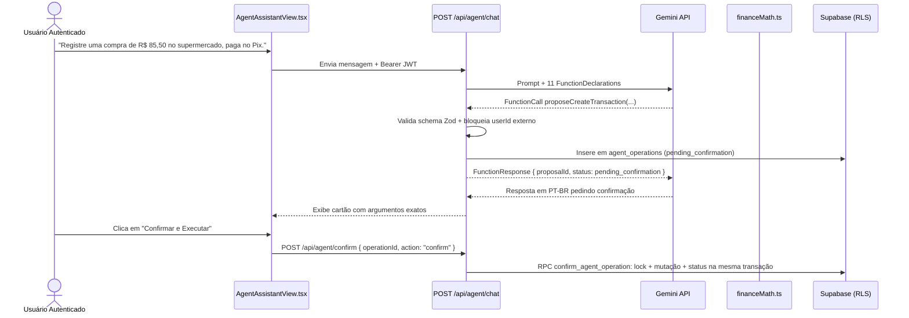

# Agente Financeiro IA e Scanner — Aconchego Finanças

## 1. Arquitetura do Agente (`src/server/agentService.ts`)

O Assistente Financeiro utiliza o SDK oficial `@google/genai` (`^3.4.0`, `apiVersion: 'v1beta'`) no backend, com **function calling real** controlado por schemas `zod` (`.strict()`), modelo configurável via `GEMINI_MODEL` (padrão: `gemini-2.5-flash`) e fallback automático para `gemini-flash-lite-latest` em respostas `404`/`503` de modelo indisponível ou alta demanda.

### Fluxo de Execução

## 2. Catálogo das 11 Ferramentas

| Ferramenta | Tipo | O que faz |
|---|---|---|
| `getFinancialSummary` | Leitura | Calcula entradas pagas/pendentes, saídas pagas/pendentes, saldo do período e saldo geral efetivado. |
| `listTransactions` | Leitura | Filtra lançamentos reais do usuário por período, tipo, categoria, status, pagamento ou busca. |
| `listBudgets` | Leitura | Calcula gasto efetivado, pendente, restante, percentual e alertas de proximidade/estouro. |
| `listFinancialGoals` | Leitura | Lista cofrinhos do usuário e calcula progresso (%) e valor restante. |
| `analyzeSpending` | Análise | Ranqueia categorias com maiores despesas efetivadas no período com aviso educacional. |
| `suggestBudgetPlan` | Sugestão | Gera alocação educacional de referência baseada na renda registrada ou informada. |
| `proposeCreateTransaction` | Proposta | Cria registro `pending_confirmation` para nova receita ou despesa. |
| `proposeUpdateTransaction` | Proposta | Valida existência da transação do usuário e propõe alterações para confirmação. |
| `proposeDeleteTransaction` | Proposta | Valida existência da transação do usuário e propõe exclusão com confirmação obrigatória. |
| `proposeUpdateBudget` | Proposta | Propõe criação/ajuste de limite mensal em categoria de despesa. |
| `proposeGoalContribution` | Proposta | Valida existência do cofrinho e saldo para resgate; propõe depósito ou retirada. |

## 3. Salvaguardas Obrigatórias

- **Isolamento de proprietário:** O `userId` é extraído exclusivamente do JWT validado em `authMiddleware.ts`. Qualquer tentativa de enviar `userId`, `user_id` ou `ownerId` nos argumentos de ferramenta é bloqueada por `assertNoOwnerOverride` e por `.strict()` nos schemas Zod.
- **Cálculos determinísticos:** Somas, subtrações, percentuais e saldos são sempre calculados em `src/utils/financeMath.ts` usando centavos inteiros.
- **Confirmação humana obrigatória:** Nenhuma ferramenta `propose*` altera `transactions`, `budgets`, `financial_goals` ou `goal_contributions`. A alteração só ocorre via `/api/agent/confirm` após clique explícito do usuário.
- **Atomicidade e idempotência:** a RPC `confirm_agent_operation` usa `SELECT FOR UPDATE`, verifica proprietário e status e efetua a mutação e o registro de execução na mesma transação. Uma falha desfaz tudo; confirmações concorrentes resultam em uma execução e HTTP `409` para a repetição. A função é `SECURITY INVOKER`, mantém RLS e só concede `EXECUTE` a `authenticated`.
- **Demonstração:** o consumo de Gemini sem login fica desativado por padrão. `ENABLE_DEMO_AI=true` permite ativá-lo explicitamente; o restante da interface demo continua disponível sem login.
- **Limites de execução:** Máximo de 3 rodadas de function calling e 6 chamadas de ferramenta por turno, timeout de 30s e rate limiting (`SlidingWindowRateLimiter`).
- **Proteção contra Prompt Injection e sanitização de logs:** caracteres de controle são removidos da entrada do usuário; descrições/notas e textos lidos em comprovantes são explicitamente isolados como dados não confiáveis nas instruções do sistema; erros internos não registram payloads financeiros ou tokens nos logs do servidor.
- **Conformidade:** O agente não recomenda investimentos ou produtos financeiros específicos e anexa aviso educacional (`EDUCATIONAL_DISCLAIMER`) em análises e planos de orçamento.

## 4. Scanner Inteligente de Comprovantes (`src/server/receiptScanner.ts`)

1. Aceita imagens **JPG, PNG e WebP** até **8 MB**.
2. Valida os **magic bytes reais** do buffer decodificado (`detectImageMimeFromMagicBytes`), rejeitando arquivos falsificados ou incompatíveis (HTTP 415/400).
3. Calcula o hash **SHA-256** do arquivo e bloqueia importações repetidas (HTTP 409 + constraint `UNIQUE (user_id, file_hash)` no banco).
4. Envia a imagem ao Gemini (`apiVersion: 'v1beta'`) configurado via `GEMINI_MODEL` (com contingência automática em `gemini-flash-lite-latest`) usando schema estruturado e timeout de 25s.
5. Rejeita documentos ilegíveis ou não financeiros (HTTP 422) e lista eventuais campos incertos em `uncertainFields`.
6. O frontend (`ScanReceiptView.tsx`) exibe uma **prévia editável** com destaque para os campos incertos e **exige confirmação humana** antes de enviar a imagem ao bucket privado e gravar a transação.
