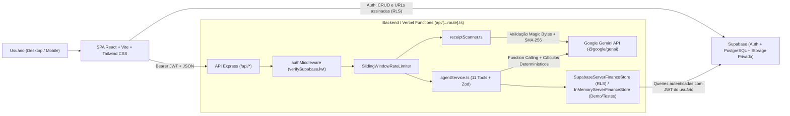

# Arquitetura — Aconchego Finanças

Este documento descreve a arquitetura implementada no repositório após a evolução full stack do protótipo original em React + Vite + Express.

## 1. Visão Geral

O **Aconchego Finanças** mantém um frontend Single Page Application (SPA) construído com **React 19, TypeScript, Vite e Tailwind CSS v4**, integrado a:

- **Supabase** para autenticação (`Supabase Auth`), banco relacional (`PostgreSQL` com Row Level Security) e armazenamento privado de imagens (`Supabase Storage`).
- **Backend Node.js / Express** (`src/server/app.ts`) compatível tanto com execução local integrada ao Vite (`server.ts`) quanto com **Vercel Functions** (`api/[...route].ts` + `vercel.json`).
- **Google Gemini API (`@google/genai`)** executada exclusivamente no servidor para interpretação de comprovantes (`/api/receipts/scan`) e para o agente financeiro com function calling (`/api/agent/chat` e `/api/agent/confirm`).

## 2. Diagrama de Arquitetura

## 3. Estrutura de Módulos

- `src/App.tsx`: Orquestrador de sessão (`AuthView` vs usuário autenticado vs Modo Demonstração voluntário), carregamento via `FinanceRepository`, sincronização entre todas as 7 visões (`overview`, `transactions`, `scan`, `assistant`, `budgets`, `piggybanks`, `receipts`) e modais.
- `src/services/financeRepository.ts`: Camada de acesso a dados com duas implementações isoladas:
  - `SupabaseFinanceRepository`: persistência real no PostgreSQL e upload em buckets privados (`receipts`, `goal-images`) com geração de URLs assinadas temporárias.
  - `DemoFinanceRepository`: persistência isolada em `localStorage` exclusivamente para o Modo Demonstração voluntário.
- `src/utils/financeMath.ts`: Regras contábeis e financeiras determinísticas em centavos inteiros (`toCents`, `fromCents`, `calculatePeriodSummary`, `calculateBudgetStatuses`, `calculateGoalProgress`, `applyGoalContribution`, `calculateCategorySpending`).
- `src/utils/assets.ts`: Importação estática de imagens locais (`src/assets/images/*`) para resolução correta após o build da Vercel/Vite, tipada via `src/vite-env.d.ts` (evitando erro `TS2688` na compilação serverless).
- `src/server/` (`imports ESM com extensão .js` para compatibilidade com Node 24 nas Vercel Functions):
  - `app.ts`: Fábrica Express desacoplada para execução local, serverless e testes com `supertest`, com logs de erro sanitizados (sem exposição de stacks ou credenciais em produção).
  - `authMiddleware.ts`: Validação de token JWT via `supabase.auth.getUser(token)` e rejeição de requisições não autenticadas (com logs sanitizados para `err.message`).
  - `rateLimiter.ts`: Limitador de taxa por usuário/IP em janela deslizante.
  - `schemas.ts`: Schemas `zod`, detecção de MIME real por magic bytes e bloqueio de parâmetros `userId` gerados por IA.
  - `receiptScanner.ts`: Leitura estruturada de documentos fiscais e contas via `@google/genai` com timeout, hash SHA-256 anti-duplicação, marcação de `uncertainFields` e instruções anti-prompt-injection contra texto malicioso embutido em recibos.
  - `agentService.ts`: Loop de function calling com máximo de 3 rodadas, cálculos determinísticos, saneamento de caracteres de controle, regras anti-prompt-injection e propostas de gravação aguardando confirmação humana.
  - `dataStore.ts`: Persistência do agente e execução idempotente de operações confirmadas.

## 4. Fluxo de Desenvolvimento e Separação de Requisitos

O protótipo original baseava-se em estado local no `localStorage`, mês inicial fixado em `2026-10`, caminhos `/src/assets/images/...` que falhariam em build de produção e chamada direta do scanner com modelo inválido (`gemini-4-hydrogen`) gravando despesas automaticamente sem revisão.

A evolução preservou integralmente a paleta acolhedora (bege `#FAF9F6`, verde floresta `#274A3C`/`#3F6253`, terracota `#E0835D`/`#C96846`), as tipografias (`Plus Jakarta Sans` e `JetBrains Mono`) e os 6 fluxos originais, adicionando a camada segura de backend, banco relacional e Assistente IA.
