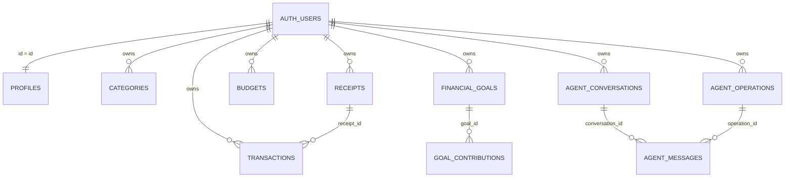

# Banco de Dados, Segurança (RLS) e Storage — Aconchego Finanças

O esquema relacional está versionado nas migrations:
- [`supabase/migrations/20261117000001_initial_schema.sql`](../supabase/migrations/20261117000001_initial_schema.sql) — schema inicial, RLS, triggers de imutabilidade/atomicidade e buckets privados.
- [`supabase/migrations/20261118000002_security_advisors_hardening.sql`](../supabase/migrations/20261118000002_security_advisors_hardening.sql) — hardening para Security & Performance Advisors do Supabase (`SET search_path = public` em funções, `REVOKE EXECUTE ON FUNCTION public.handle_new_user() FROM PUBLIC, anon, authenticated`, políticas RLS com `(select auth.uid())` para evitar `auth_rls_initplan` e índices adicionais de chaves estrangeiras).

> **Estado no Supabase remoto (`RHU4N's Project` / `fhrmqspsxnodlftunsfa`):** ambas as migrations aplicadas e registradas em `supabase_migrations.schema_migrations`; **0 alertas no Security Advisor** (`get_advisors`); triggers (`on_auth_user_created`, `apply_goal_contribution_trigger`, `prevent_user_id_change`), buckets privados (`receipts`, `goal-images`, `public = false`) e isolamento estrito entre duas contas testados diretamente no PostgreSQL 17.

## 1. Modelo Entidade-Relacionamento

## 2. Tabelas e Regras Monetárias

Todos os valores monetários utilizam `numeric(14,2)` com constraints `CHECK` no PostgreSQL:

| Tabela | Propósito | Principais Constraints |
|---|---|---|
| `profiles` | Perfil associado a `auth.users(id)` | PK/FK `ON DELETE CASCADE`, `id` imutável via trigger |
| `categories` | Categorias de despesa/receita do usuário | `UNIQUE (user_id, name)`, `kind IN ('expense', 'income')` |
| `receipts` | Metadados de comprovantes e referência ao Storage | `UNIQUE (user_id, file_hash)`, `mime_type IN ('image/jpeg','image/png','image/webp')` |
| `transactions` | Receitas e despesas | `amount > 0`, `type IN ('income','expense')`, `status IN ('paid','pending')`, `UNIQUE (user_id, idempotency_key)` |
| `budgets` | Limites por categoria e período (`monthly` ou `YYYY-MM`) | `limit_amount > 0`, `UNIQUE (user_id, category, period)` |
| `financial_goals` | Cofrinhos / metas pessoais | `target_amount > 0`, `current_amount >= 0` |
| `goal_contributions` | Histórico de depósitos e retiradas | `amount > 0`, `type IN ('deposit','withdraw')`, trigger atômica `apply_goal_contribution_trigger` |
| `agent_conversations` | Sessões de conversa com o agente | `user_id` imutável |
| `agent_messages` | Histórico de mensagens, `tool_traces` e `disclaimer` | FK para `agent_conversations` e `agent_operations` |
| `agent_operations` | Propostas aguardando confirmação e log idempotente | `status IN ('pending_confirmation','executed','cancelled','failed')`, `UNIQUE (user_id, idempotency_key)` |

## 3. Segurança e Row Level Security (RLS)

1. **RLS ativado em todas as 10 tabelas** com políticas explícitas de `SELECT`, `INSERT`, `UPDATE` e `DELETE` restritas a `auth.uid() = user_id` (ou `auth.uid() = id` em `profiles`).
2. **Prevenção de leitura/escrita cruzada:** políticas de `INSERT` e `UPDATE` em tabelas filhas (`transactions.receipt_id`, `goal_contributions.goal_id`, `agent_messages.conversation_id`) verificam por subconsulta que o registro pai também pertence a `auth.uid()`.
3. **Imutabilidade de proprietário:** triggers `prevent_user_id_change()` e `prevent_profile_id_change()` lançam exceção se qualquer `UPDATE` tentar alterar `user_id` ou `profiles.id`.
4. **Provisionamento limpo de novos usuários:** a trigger `handle_new_user()` cria apenas o registro em `profiles` e as 9 categorias padrão em `categories`. Nenhum dado fictício de `initialData.ts` é inserido automaticamente.
5. **Execução no servidor:** o backend utiliza a Publishable Key associada ao cabeçalho `Authorization: Bearer <JWT>` do usuário autenticado, garantindo que toda leitura/escrita do servidor passe pelo RLS do PostgreSQL.

## 4. Storage Privado

- Buckets criados: `receipts` e `goal-images`, ambos configurados com `public = false`, limite de `8 MB` (`8388608` bytes) e MIME types restritos a `image/jpeg`, `image/png` e `image/webp`.
- Políticas em `storage.objects` permitem `SELECT`, `INSERT`, `UPDATE` e `DELETE` somente quando `(storage.foldername(name))[1] = auth.uid()::text`.
- O frontend gera URLs assinadas com expiração de 1 hora (`createSignedUrl(path, 3600)`) para exibição das miniaturas e ampliação no lightbox.

### Confirmação transacional e integridade adicional

A migration `20261118034542_atomic_agent_confirmation.sql`, aplicada com autorização ao projeto `fhrmqspsxnodlftunsfa`, acrescenta a RPC `confirm_agent_operation`. Ela bloqueia a proposta e grava a mutação e o status na mesma transação, sem `SECURITY DEFINER` nem chave privilegiada. Políticas restritivas verificam o proprietário da conversa/operação e o prefixo do caminho do recibo. Contribuições não podem ser apagadas isoladamente; excluir o cofrinho ainda remove seu histórico por cascata.

O arquivo local foi alinhado à versão `20261118034542` registrada pelo MCP. Não reaplique migrations já registradas. Os testes em `supabase/tests/financial_integrity.sql` são exclusivamente para banco local descartável e terminam com `ROLLBACK`.

## 5. Limites de E-mail (SMTP) do Supabase Auth

O SMTP padrão do Supabase possui limite estrito de envio por hora (voltado apenas para testes) e entrega restrita dependendo do plano. Para uso público em produção:

1. No painel do Supabase, acesse **Authentication → SMTP Settings**.
2. Ative **Enable Custom SMTP** e configure um provedor transacional dedicado (Resend, Postmark, SendGrid ou Amazon SES).
3. Configure domínio verificado (SPF/DKIM/DMARC) e `Site URL` / `Redirect URLs` apontando para o domínio da aplicação na Vercel.
4. **Não** desative a confirmação de e-mail nem reduza políticas de segurança para contornar limites do SMTP padrão.
